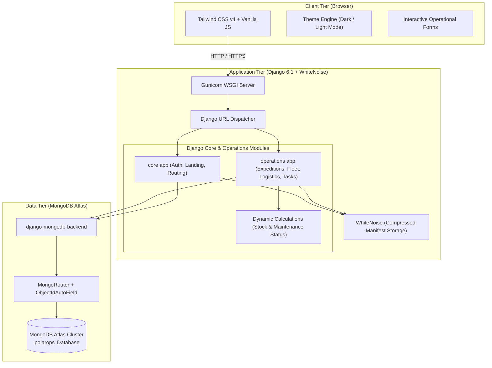

# ❄️ PolarOps — Polar Expedition Logistics & Asset Management Platform

<div align="center">

[](https://www.djangoproject.com/)
[](https://www.mongodb.com/)
[](https://tailwindcss.com/)
[](https://www.python.org/)
[](https://render.com/)
[](LICENSE)

<p align="center">
  <b>A mission-critical operations, logistics coordination, and extreme-environment asset tracking platform built for polar scientific teams and Arctic/Antarctic expeditions.</b>
</p>

[Explore Features](#-key-features) •
[Architecture](#-system-architecture) •
[Quickstart](#-quick-start--installation) •
[Data Seeding](#-seed-realistic-operational-data) •
[Deployment](#-deployment) •
[Project Structure](#-project-structure)

</div>

---

## 📌 Executive Summary

Conducting scientific and logistical operations in the polar regions (Arctic and Antarctic) entails extreme environmental challenges: sub-zero temperatures down to -50°C, isolated research outposts, complex supply chains reliant on weather windows, and zero tolerance for equipment failure.

**PolarOps** is an enterprise-grade operational management system designed to coordinate high-stakes scientific expeditions, manage critical machinery and survival assets, track inventory and consumables, coordinate multi-modal polar transport (ski-planes, icebreakers, snowcat convoys), and maintain situational awareness through a unified mission control dashboard.

Built on **Django 6.1** integrated with **MongoDB Atlas** via native ODM routing, **PolarOps** pairs high-throughput document storage with a sleek, responsive interface built with **Tailwind CSS v4** featuring native Dark/Light mode support.

---

## ✨ Key Features

### 🧭 1. Mission Control Center (Operations Dashboard)
- **Live KPI Metrics**: Instant glance at active expeditions, deployed personnel count, operational equipment ratio, pending mission tasks, critical low-stock alerts, and overdue maintenance items.
- **Dynamic Risk Detection**: On-the-fly calculation of assets requiring immediate maintenance attention and supplies dipping below survival thresholds.
- **Real-Time Activity Stream**: Chronological feed recording all operations, dispatches, status shifts, and resource allocations.
- **Priority Task Radar**: Direct access to high- and critical-priority assignments requiring immediate intervention.

### ❄️ 2. Expedition Lifecycle Management
- **End-to-End Status Pipeline**: Manage expeditions across four operational states: `Planned`, `Active`, `Completed`, and `Cancelled`.
- **Comprehensive Expedition Dossier**: Dedicated detail view consolidating linked research stations, rostered personnel, assigned vehicle/asset fleets, mission task milestones, and inbound/outbound logistics shipments.
- **Scientific Objectives Tracking**: Document core research goals, environmental parameters, and detailed operational briefings.

### 🚜 3. Extreme-Climate Fleet & Asset Inventory
- **Specialized Categorization**: Track polar-specific equipment including *Snowmobiles, Generators, Satellite Phones, GPS Transceivers, Ice Core Drills, Heating Systems, Communication Gear, Protective Survival Suits, and Heavy Overland Vehicles*.
- **Predictive Maintenance Engine**: Automatically flags assets as **Up to Date (Emerald)**, **Maintenance Soon (Amber - within 14 days)**, or **Overdue (Red)**.
- **Service History**: Historical logs of all scheduled checkups, cold-weather overhauls, calibrations, and emergency repairs linked per asset.

### 📦 4. Consumables & Survival Supply Chain
- **Critical Inventory Types**: Management for high-calorie polar rations, aviation/generator fuel, medical kits, potable water, cold-weather lithium batteries, research reagents, and emergency survival caches.
- **Automated Low-Stock Trigger**: Dynamic threshold alerts triggering whenever `quantity <= minimum_required_quantity`.
- **Location-Based Storage**: Track shelf-life, expiry dates, and specific storage depot facilities across disparate camps.

### ✈️ 5. Multi-Modal Polar Logistics & Transport
- **Arctic & Antarctic Transport Methods**: Track shipments via *Ski-Plane Air Drop, Twin Otter Cargo Flight, Icebreaker Vessel, Snowcat Overland Convoy, Helicopter Sling, and Snowmobile Sled*.
- **Waypoint Routing**: Monitor origin, destination, dispatch date, estimated arrival date, and real-time transit status (`Planned`, `In Transit`, `Delivered`, `Delayed`, `Cancelled`).

### 🔧 6. Maintenance & Engineering Records
- **Service Typologies**: Structured workflows for *Scheduled Service, Pre-Departure Inspection, Cold-Weather Overhaul, Emergency Repair, and Sensor Calibration*.
- **Accountability**: Tie service entries directly to technicians, asset IDs, and subsequent inspection target dates.

### 📋 7. Mission Tasks & Operations Checklist
- **Priority Matrix**: Triage tasks by priority (`Low`, `Medium`, `High`, `Critical`).
- **One-Click State Toggle**: Rapidly toggle completion status directly from the list view.
- **Expedition & Personnel Delegation**: Assign tasks to designated field personnel and specific expeditions.

### 🗺️ 8. Polar Stations & Field Locations
- **Outpost Typologies**: Categorization for *Permanent Research Stations* (e.g., Ny-Ålesund, McMurdo), *Expedition Ice Camps* (e.g., Summit Station Greenland), *Depot Facilities* (e.g., Tromsø Logistics Depot), and *Remote Field Sites* (e.g., Fram Strait Sea-Ice Station).
- **Geospatial Coordinates**: Store latitude and longitude coordinates for remote field sites.
- **Station Overview**: View all expeditions, equipment stationed, and supplies stockpiled at any individual facility.

### 🔒 9. Security & Access Control
- **Authentication**: Fully styled Django authentication (Sign in, Sign out, and User Registration).
- **Protected Endpoints**: Strict `@login_required` decorators guarding all operational endpoints.
- **Production Hardening**: Enforced SSL redirection, secure cookies, and proxy headers when running in production mode.

---

## 🏛️ System Architecture



---

## 💻 Tech Stack & Dependencies

| Category | Technology | Description |
| :--- | :--- | :--- |
| **Backend Framework** | **Django 6.1** | High-level Python web framework powering routing, MVC views, ORM, and auth |
| **Database** | **MongoDB Atlas** | Cloud-native NoSQL document database providing resilient, schema-flexible storage |
| **DB Connector** | **`django-mongodb-backend` (v6.1.0)** | Official MongoDB backend engine for Django 6+ |
| **DNS Resolver** | **`dnspython`** | Supports SRV connection strings (`mongodb+srv://`) |
| **Frontend Styling** | **Tailwind CSS v4** | Modern utility-first CSS framework with class-based dark mode |
| **UI Enhancements** | **Vanilla CSS + JS** | Custom glassmorphism, responsive drawer, count-up animations, scroll-reveal |
| **Static Assets** | **WhiteNoise 6.0+** | Self-contained static asset compression and caching for production |
| **WSGI Server** | **Gunicorn 26.0+** | Production-grade WSGI HTTP Server |
| **Image Processing** | **Pillow 12.0+** | Python imaging library for file uploads and asset processing |

---

## 🚀 Quick Start & Installation

### 1. Prerequisites
- **Python 3.11** or **Python 3.12**
- **Git**
- A **MongoDB Atlas** database cluster (or local MongoDB 6.0+ instance)

### 2. Clone the Repository
```bash
git clone https://github.com/pramodpandit72/PolarOps.git
cd PolarOps
```

### 3. Create and Activate a Virtual Environment
```bash
# Windows (PowerShell)
python -m venv .venv
.venv\Scripts\Activate.ps1

# Linux / macOS
python3 -m venv .venv
source .venv/bin/activate
```

### 4. Install Dependencies
```bash
pip install -r requirements.txt
```

### 5. Configure Environment Variables
Copy the `.env.example` file to create your local `.env`:
```bash
# Windows
copy .env.example .env

# Linux / macOS
cp .env.example .env
```

Open `.env` and configure your credentials:
```env
SECRET_KEY=your-secure-random-secret-key
DEBUG=True
ALLOWED_HOSTS=localhost,127.0.0.1,*
MONGODB_URI=mongodb+srv://<db_user>:<db_password>@<cluster-address>/?appName=PolarOpsCluster
```

### 6. Apply Database Migrations
PolarOps uses customized MongoDB migrations for core Django auth, contenttypes, and operations models:
```bash
python manage.py migrate
```

### 7. Create a Superuser (Optional)
```bash
python manage.py createsuperuser
```

---

## 🧪 Seed Realistic Operational Data

PolarOps comes with a built-in operational seeding command that populates the database with authentic Arctic and Antarctic research data (stations, active traverses, snowmobiles, flight records, rations, and personnel):

```bash
python manage.py seed_data
```

This seeds:
- 🏢 **5 Polar Stations & Camps**: *Ny-Ålesund (Svalbard), Summit Station (Greenland), McMurdo Base (Ross Island), Tromsø Logistics Depot, and Fram Strait Outpost*.
- 🧭 **4 Expeditions**: *Glacier Dynamics Traverse, Fram Strait Acoustic Monitoring, McMurdo Deep Ice Drilling, and Summit Aerosol Survey*.
- 👥 **Personnel**: Leaders, glaciologists, logistics coordinators, mechanics, and medical officers.
- 🚜 **Assets**: Yamaha snowmobiles, Caterpillar generators, Iridium satellite phones, GPS units, and survival shelters.
- 📦 **Supplies**: Extreme-calorie cold ration packs, Arctic-grade Jet A-1 fuel, survival medical kits, and batteries.
- ✈️ **Logistics Shipments**: Scheduled Twin Otter cargo runs, ski-plane drops, and icebreaker deliveries.
- 📋 **Operational Tasks & Service Schedules**: Priority maintenance tasks, pre-departure checklists, and activity log entries.

---

## 🏃 Running the Application Locally

```bash
python manage.py runserver
```

Open your browser and navigate to:
- **Landing Page**: [http://127.0.0.1:8000/](http://127.0.0.1:8000/)
- **Sign In**: [http://127.0.0.1:8000/login/](http://127.0.0.1:8000/login/)
- **Operations Dashboard**: [http://127.0.0.1:8000/dashboard/](http://127.0.0.1:8000/dashboard/)
- **Django Admin**: [http://127.0.0.1:8000/admin/](http://127.0.0.1:8000/admin/)

---

## 🌐 Deployment

PolarOps includes a production-ready `render.yaml` specification for deploying to **Render**:

```yaml
services:
  - type: web
    name: polarops
    runtime: python
    buildCommand: "pip install -r requirements.txt && python manage.py collectstatic --noinput && python manage.py migrate"
    startCommand: "gunicorn config.wsgi:application"
    envVars:
      - key: SECRET_KEY
        generateValue: true
      - key: DEBUG
        value: "False"
      - key: ALLOWED_HOSTS
        value: ".onrender.com"
      - key: MONGODB_URI
        sync: false
```

### Steps to Deploy on Render:
1. Push your code to GitHub.
2. Sign in to [Render](https://render.com) and click **New > Blueprint**.
3. Select your `PolarOps` repository.
4. Set the `MONGODB_URI` environment variable in the Render Dashboard with your MongoDB Atlas connection string.
5. Click **Apply** — Render will automatically build the environment, collect static assets via WhiteNoise, execute migrations, and start Gunicorn.

---

## 📁 Project Structure

```plaintext
PolarOps/
├── config/                     # Project configuration & settings
│   ├── apps.py                 # Custom ObjectId configs for Admin/Auth
│   ├── asgi.py                 # ASGI entrypoint
│   ├── settings.py             # Django settings (MongoDB backend, WhiteNoise)
│   ├── urls.py                 # Root URL routing
│   └── wsgi.py                 # WSGI entrypoint for Gunicorn
├── core/                       # Public & user-facing core application
│   ├── urls.py                 # Landing page & signup routes
│   └── views.py                # Landing view & signup controller
├── operations/                 # Mission-critical polar operations module
│   ├── forms.py                # Tailwind-styled forms for all operational models
│   ├── models.py               # Schema definitions (Expedition, Asset, Supply, etc.)
│   ├── urls.py                 # Operation endpoints (CRUD for 8 entities)
│   ├── views.py                # Controllers, search/filters, dynamic calculation logic
│   └── management/
│       └── commands/
│           └── seed_data.py    # Comprehensive seed data script
├── mongo_migrations/           # Specialized MongoDB migration packages
│   ├── admin/                  # MongoDB migrations for Django Admin
│   ├── auth/                   # MongoDB migrations for Django Auth
│   └── contenttypes/           # MongoDB migrations for Django ContentTypes
├── static/                     # Static source assets
│   ├── css/
│   │   └── style.css           # Glassmorphism, animations, custom theme utilities
│   └── js/
│       └── app.js              # Theme switcher, scroll observer, counter animations
├── staticfiles/                # Collected & compressed production assets (WhiteNoise)
├── templates/                  # Django HTML templates
│   ├── base.html               # Public base template with Tailwind & theme init
│   ├── app_base.html           # Authenticated application shell with responsive sidebar
│   ├── landing.html            # Public marketing landing page
│   ├── dashboard.html          # Mission Control operational dashboard
│   ├── operations/             # CRUD templates for all operational resources
│   │   ├── expedition_list.html / expedition_detail.html / expedition_form.html
│   │   ├── asset_list.html / asset_detail.html / asset_form.html
│   │   ├── supply_list.html / supply_form.html
│   │   ├── logistics_list.html / logistics_form.html
│   │   ├── maintenance_list.html / maintenance_form.html
│   │   ├── task_list.html / task_form.html
│   │   ├── location_list.html / location_detail.html / location_form.html
│   │   └── confirm_delete.html # Generic modal confirmation template
│   └── registration/
│       ├── login.html          # User authentication login view
│       └── signup.html         # User registration view
├── .env.example                # Sample environment configuration template
├── manage.py                   # Django CLI management script
├── render.yaml                 # Infrastructure as Code specification for Render
└── requirements.txt            # Python package dependencies
```

---

## 🛡️ Security Hardening

When `DEBUG=False` (Production mode):
- `SECURE_SSL_REDIRECT = True`: All HTTP traffic is forcefully redirected to HTTPS.
- `SECURE_PROXY_SSL_HEADER = ('HTTP_X_FORWARDED_PROTO', 'https')`: Transparent reverse proxy support behind Render / Cloudflare load balancers.
- `SESSION_COOKIE_SECURE = True` & `CSRF_COOKIE_SECURE = True`: Authentication session and CSRF cookies are strictly restricted to encrypted HTTPS connections.
- `X-Frame-Options` and clickjacking protection middleware enabled by default.

---

## 🔮 Roadmap

- [ ] **Offline PWA & Service Workers**: Enable offline caching of checklists and inventory logs for field personnel operating outside satellite range.
- [ ] **Interactive GIS Polar Map**: Leaflet/Mapbox integration visualizing stations, GPS asset locations, and ice-shelf boundary overlays.
- [ ] **Satellite IoT Telemetry Hook**: Ingest automated temperature, battery, and GPS telemetry via Iridium / Starlink webhooks.
- [ ] **Weather & Sea-Ice API Feed**: Real-time Arctic/Antarctic meteorological forecasts and blizzards alerts directly on the dashboard.

---

## 📄 License

This project is licensed under the **MIT License** — feel free to use, modify, and distribute for personal, educational, or commercial operations.

---

<div align="center">
  <sub>Developed for polar scientific missions, extreme logistics, and cold-region research teams worldwide.</sub>
</div>
